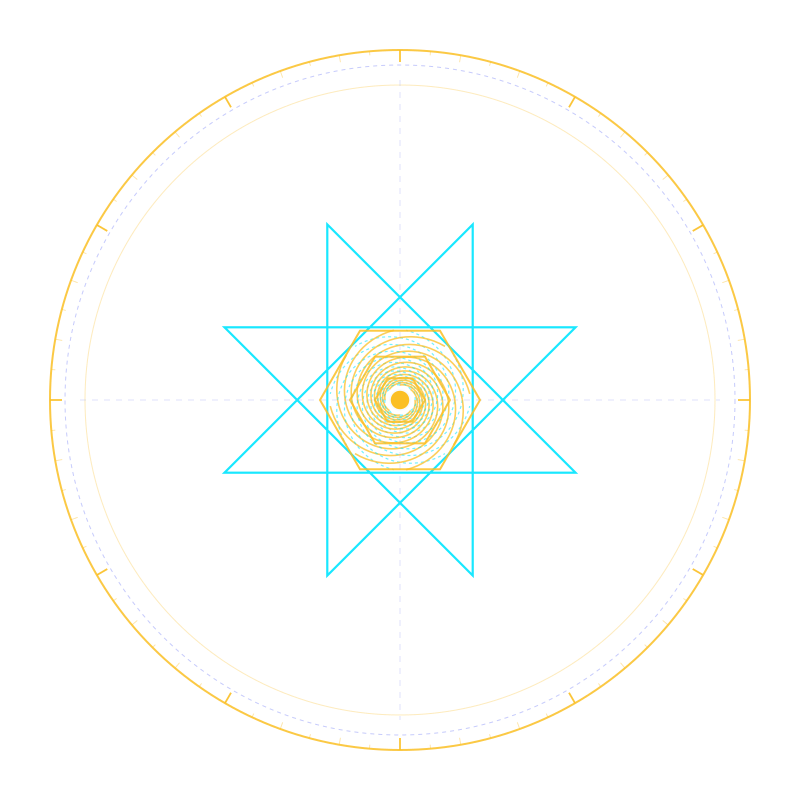

# 🛡️ Aegis DNS (`aegis-dist`) — Official Distribution & Verification Hub

> **Microsecond Authoritative & Defensive Sinkhole DNS Daemon, RFC 2308 Topology-Aware Filter & Mirage Deception Engine**  
> *Zero cloud dependencies • Pure safe Rust • Musl static standalone binary • 100% Adversarial TDD Tested*

[](https://github.com/rmediatech/aegis-dist/releases/tag/v0.5.0)
[](https://rmediatech.com/downloads)
[-brightgreen.svg)](#)
[-blue.svg)](#)
[](#)
[-blueviolet.svg)](SOVEREIGN_RELEASE_KEY.asc)
[](https://rmediatech.com)
[](LICENSE)

<p align="center">
  
</p>

---

## 🏛️ Overview

**Aegis** is an enterprise-grade, zero-cloud authoritative DNS daemon and microsecond defensive sinkhole engineered in 100% safe Rust. Operating at Layer 3/4, Aegis provides high-throughput authoritative zone serving, active reconnaissance deception, encrypted DNS over TLS/HTTPS (DoT/DoH), and RFC 2308 topology-aware IPv6 filtering without external dependencies.

### Core Capabilities
* **FastDomainBloom & DomainRadixTrie**: Evaluates queries against 1,000,000+ domain threat feeds (StevenBlack, OISD, Adblock, Dnsmasq) using a 4-Megabit bitwise Bloom pre-filter in $<10\text{ns}$, followed by a zero-allocation reverse-label radix tree lookup.
* **Topology-Aware RFC 2308 NODATA Synthesis**: Synthesizes microsecond authoritative NODATA responses for incoming `AAAA` queries on IPv4-only networks, eliminating RFC 6724 Happy Eyeballs socket timeouts while strictly preserving production authoritative `AAAA` records.
* **Active Mirage Deception (`SOVEREIGN-MIRAGE-01`)**: Neutralizes offensive subdomain scouts (`subfinder`, `amass`) by deriving HMAC-SHA256 sandboxed canary records (`198.18.x.y` / `2001:db8::`), attributing attacker infrastructure in real-time.
* **Pure-Rust DNSSEC Verification**: Full RFC 4034/4035 chain validation across Ed25519 (Alg 15), ECDSA P-256/P-384, and RSA-SHA256/512 with automatic bogus rejection (`SERVFAIL`).
* **Encrypted Upstream & RFC 8767 SWR**: Native DNS-over-TLS (RFC 7858) and DNS-over-HTTPS (RFC 8484) upstream resolution with Stale-While-Revalidate caching ($<5\mu\text{s}$ cache hits).
* **Single Standalone Static Binary**: Statically linked against Musl libc, self-contained, with $<20\text{MB}$ memory footprint.

---

## 📦 Binary Verification & Download

Verified standalone binaries are distributed directly through the **[RMediaTech Sovereign Binary Vault](https://rmediatech.com/downloads)**:

| Platform | Architecture | Checksum (SHA-256) | Vault Download |
| :--- | :--- | :--- | :--- |
| **Linux (Static Musl)** | `x86_64` | `5e19a9c886838dd5534fc00e98f7cdb5b7452c8df45646d0209b9481ab347d0d` | [Download (5.1 MB)](https://rmediatech.com/bin/aegis) |

### 1-Click Stream Download & Installation
```bash
# 1-Click Stream Install
curl -sSL https://rmediatech.com/install/aegis | sh

# Or Direct Binary Download
curl -sSL https://rmediatech.com/bin/aegis -o aegis
chmod +x aegis
```

### Cryptographic Provenance Verification (`SOVEREIGN-SIGN-01`)
All releases are cryptographically sealed by `Rick Walker (Sovereign Release Signing Key) <rick@rmediatech.com>` (Key ID: `4E428019A109578B`):

```bash
# Import Public Key
curl -sSL https://rmediatech.com/SOVEREIGN_RELEASE_KEY.asc | gpg --import

# Verify Detached OpenPGP Signature
curl -sSL https://rmediatech.com/signatures/aegis -o aegis.asc
gpg --verify aegis.asc aegis
```

---

## 🚀 Quickstart

```bash
# Verify configuration and zone files
aegis check --config /etc/aegis/aegis.toml

# Run outside-in perimeter exposure audit
aegis audit-surface --self-check --config /etc/aegis/aegis.toml

# Start the sovereign DNS daemon
aegis serve --config /etc/aegis/aegis.toml
```

---

## 🛡️ License & Provenance

Dual-licensed under MIT OR Apache-2.0. Cryptographically sealed by Rick Walker (`4E428019A109578B`).
